# Cores do PhotoHouse — issue #22

Implementação local de 18/10/2026, baseada no commit `365a88cb`, conforme
[issue #22](https://github.com/HOUSE-DE-CRIATIVIDADE/PhotoHouse/issues/22).
As evidências abaixo foram produzidas na validação local anterior à abertura desta PR.

A cor-base dos destaques agora é **#6FCF68** (RGB 111, 207, 104), definida em
`theme::BRAND_ACCENT`. Os 14 temas usam a mesma base em ferramentas ativas,
botões, checkboxes e seleções. Fundos translúcidos e linhas de foco derivam dessa
cor. Temas claros usam uma derivação escura para textos e ícones; o Soft Dark
usa uma derivação ligeiramente mais clara para manter o contraste. As cores das
superfícies de cada tema e as cores semânticas foram preservadas.
Interruptores ligados usam indicador escuro sobre o verde, preservando o
contraste ao migrar temas que anteriormente usavam azul ou violeta.

A abertura usa o mesmo token: arte, quadros, layout, fonte, duração e comportamento
continuam os do checkpoint aprovado; somente os destaques mudam de cor. O código
do instalador e as orientações do tema também foram atualizados. Instaladores
antigos arquivados não foram recompilados nem substituídos.

## Verificação

- 2.692 testes unitários da interface passaram, com 12 ignorados.
- 116 testes do aplicativo passaram.
- Clippy de todos os alvos do app e da interface passou sem avisos de código.
- WebAssembly passou nos 24 alvos; a checagem de camadas passou nos 29 crates.
- A formatação do workspace foi conferida.
- Build otimizado com recursos Windows aprovado e instalado em
  `C:\photocraft-main\PhotoHouse.exe`, versão 0.8.2. SHA-256 conferido e subsistema
  gráfico Windows (2) confirmado, mantendo a execução sem terminal.
- A abertura nativa gerou capturas em 0%, 50% e 100% e terminou com código 0.
  A tela inicial do executável principal também foi capturada, usando perfil de
  teste isolado, sem alterar as preferências pessoais.
- Os 12 testes de tema incluem contraste nos 14 temas: rótulos de controles
  preenchidos mantêm 4,5:1 e ícones/linhas de foco mantêm 3:1.
- Foram geradas e inspecionadas 20 capturas antes e 20 depois: os 14 temas no
  editor, mais início, menu e diálogo em claro e escuro. Capturas com canvas CPU
  foram usadas quando necessário devido à lentidão do driver gráfico por software.
- Na captura do editor Pro Medium, os 399 pixels que usavam a cor antiga foram
  substituídos por #6FCF68; não restaram pixels da cor antiga nessa captura.
- Os 50.000 pixels verificados no documento branco sintético permaneceram iguais.
- Os arquivos de conteúdo, presets de cores, amostras e rótulos semânticos não
  foram recoloridos. O teste do tema confirma a preservação do rótulo verde.

## Antes e depois

| Editor e painéis, escuro | Editor e painéis, claro |
| --- | --- |
| 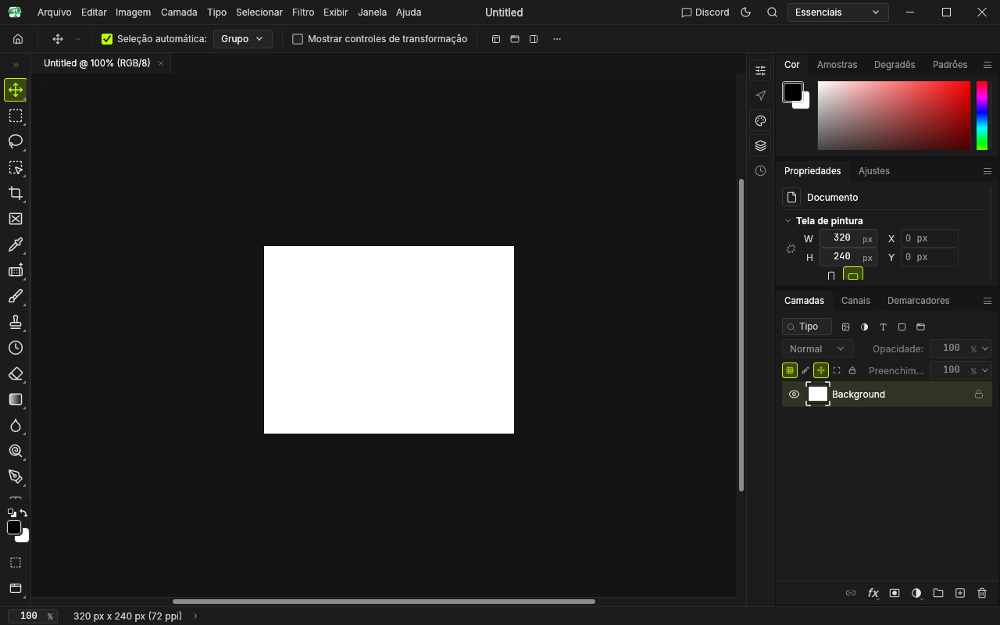 | 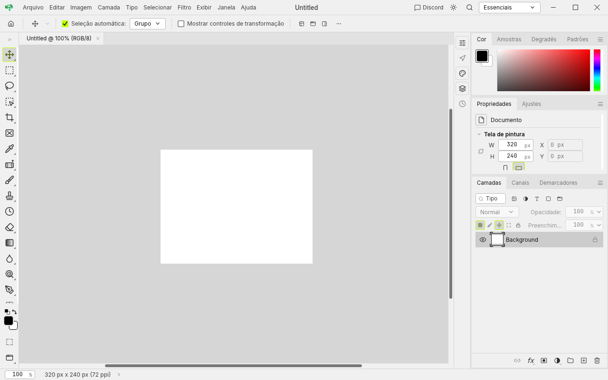 |
| 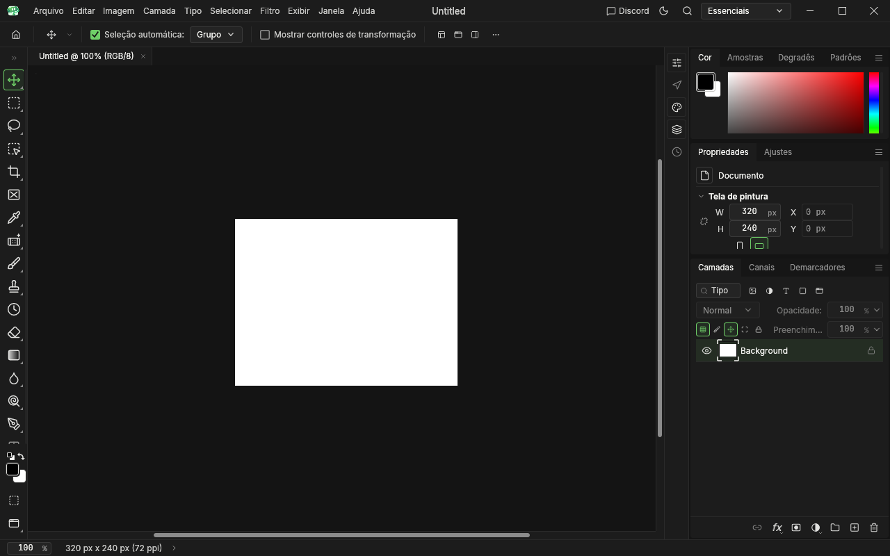 | 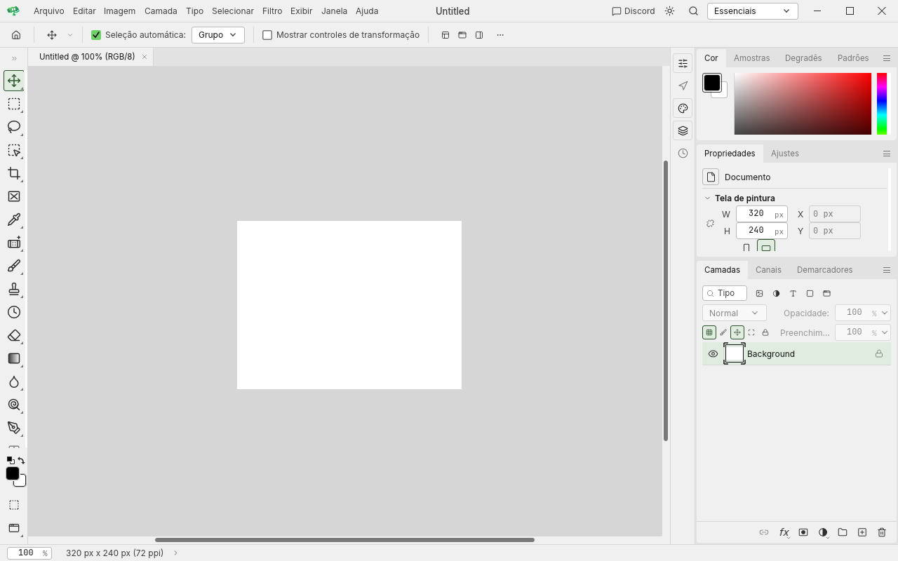 |

| Tela inicial: antes | Tela inicial: depois |
| --- | --- |
| 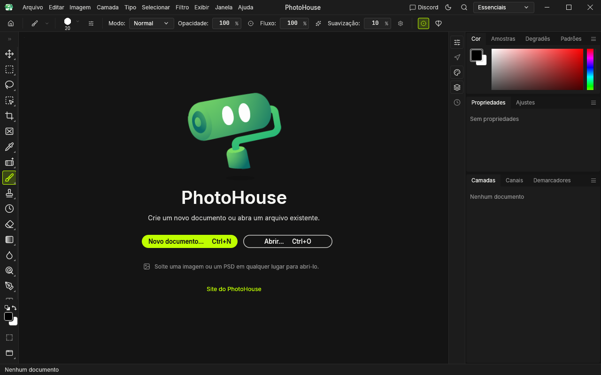 | 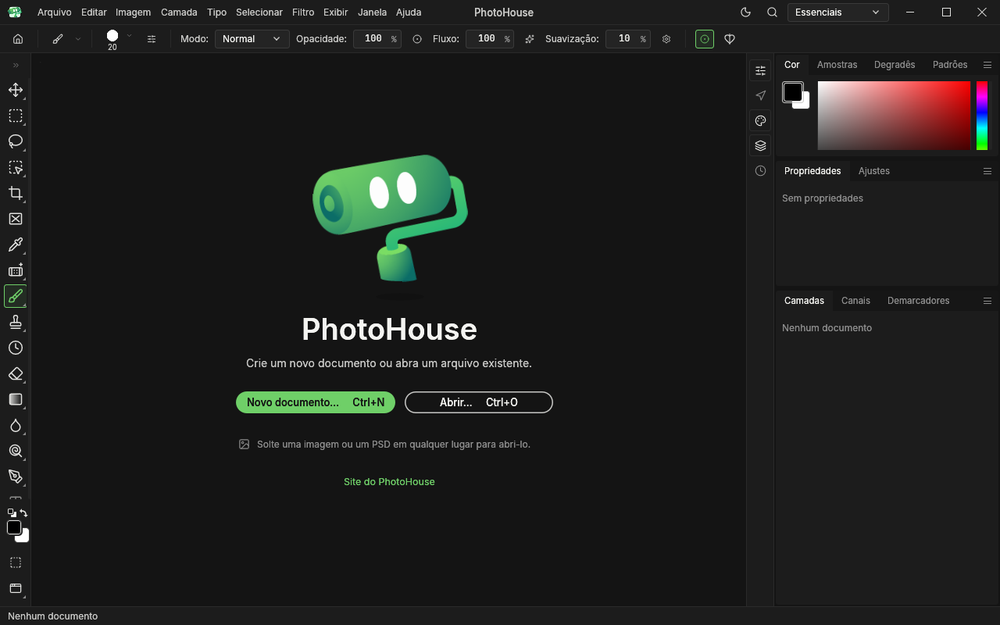 |

| Diálogo: antes | Diálogo: depois |
| --- | --- |
| 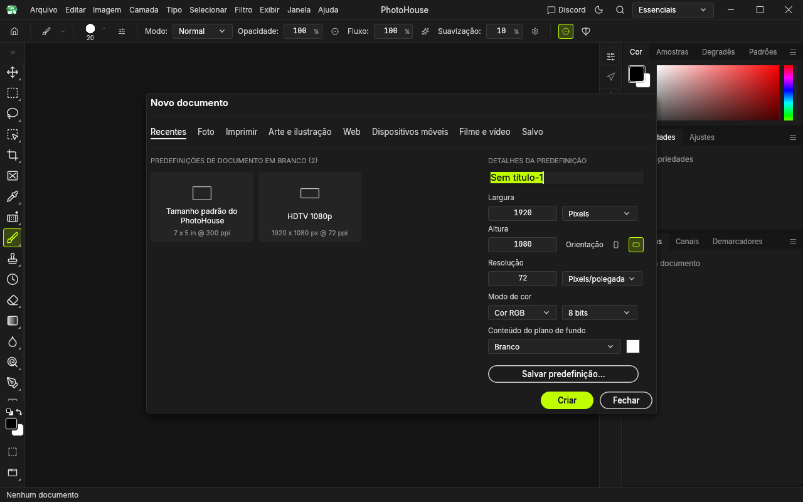 | 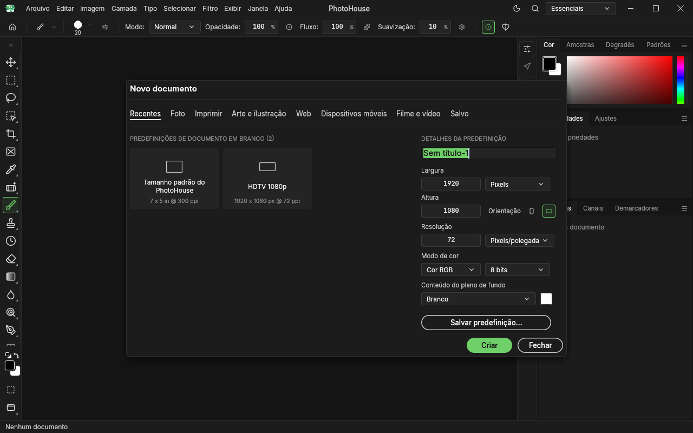 |

| Menu claro: antes | Menu claro: depois |
| --- | --- |
| 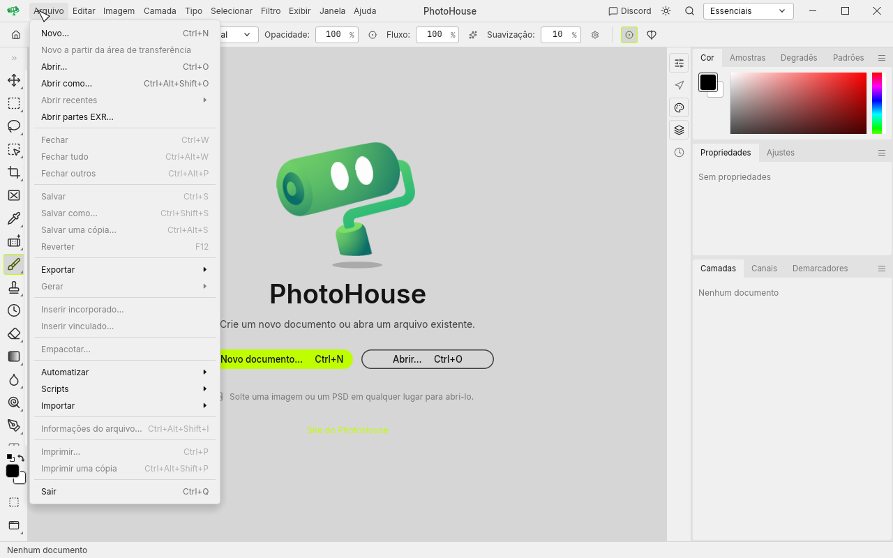 | 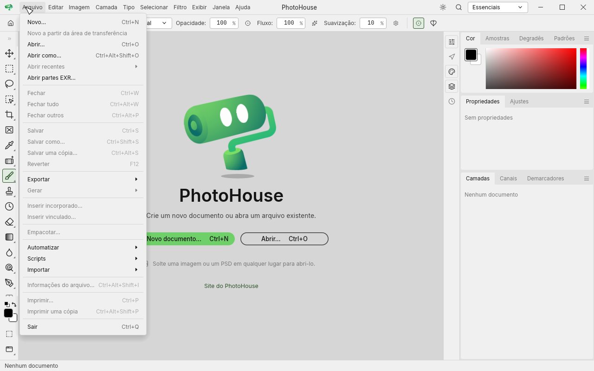 |

As demais capturas claro/escuro estão nas pastas `before/` e `after/`.

## Executável principal instalado

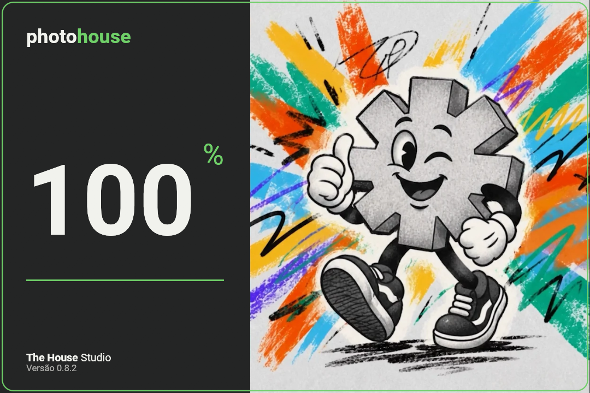

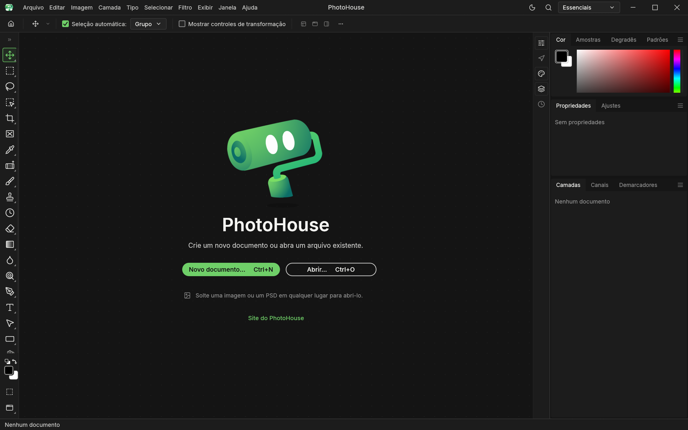

A versão anterior está preservada em
`C:\photocraft-main\old\2026-10-18-antes-cores-6FCF68`.
O código e as evidências acompanham a PR de padronização das cores.

Capturas originais locais da interface, com documento sintético branco e sem
arquivos pessoais. MIT OR Apache-2.0 para as capturas; marcas e materiais da
interface mantêm suas condições de origem. Licenças adjacentes e
[atribuições do projeto](../../../ATTRIBUTION.md).
