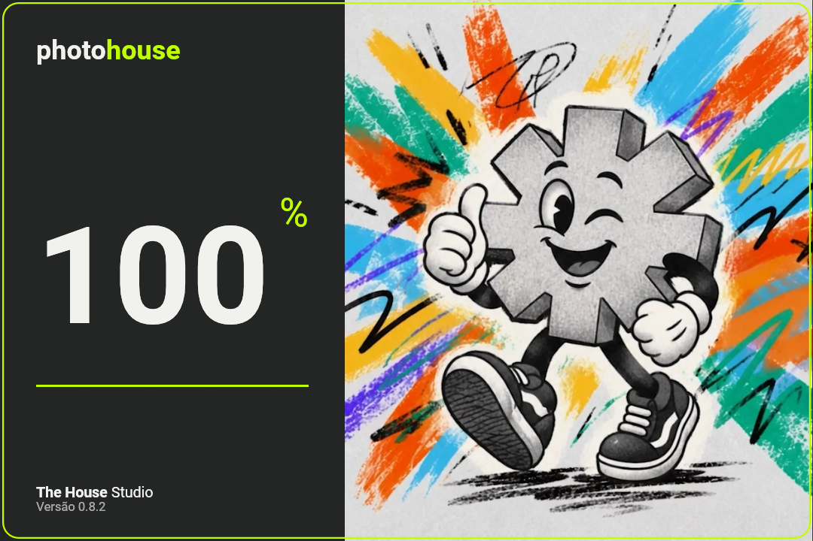
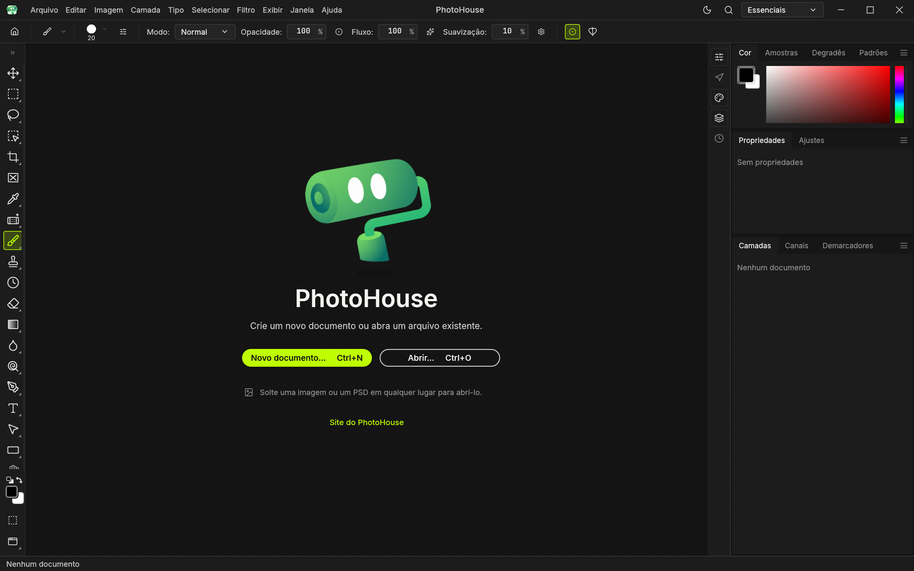

# Validação do PR #8

Executada em 17/10/2026, no Windows, sobre `9f28af04` com as correções desta branch.

**Abertura corrigida por solicitação do usuário:** a referência vigente é o checkpoint
`9e0ef51497a59035a241701e8dd7d802cb389611`, com Housinho e quadros originais,
4,16 s e pausa final de 200 ms. Esc cancela o lançamento, conforme esse checkpoint.
A captura de abertura abaixo foi substituída pela versão restaurada. O mascote
rolinho permanece somente na tela inicial; o vídeo abaixo demonstra essa tela inicial.
A execução do checkpoint revelou um panic por atlas de 5760 × 5824 acima do limite
2048 da GPU. Carregar cada quadro original de 720 × 832 separadamente corrigiu a
falha sem mudar o desenho ou reduzir a resolução. Um teste de regressão reproduz
o limite 2048. Após essa restauração, build, Clippy de todos os alvos do aplicativo,
formatação e os **116 testes do aplicativo** passaram; a abertura nativa terminou
com código 0 e gerou capturas em 0%, 50% e 100%.

## Correções

- Importar `Rot2` de `egui::emath`, permitindo compilar o mascote.
- Adaptar o teste de uploads ao mapa de listas de deltas do egui 0.36.2 e remover um `mut` desnecessário.
- Ocultar o Discord da barra superior enquanto a tela inicial está aberta; teste em 760, 1100 e 1440 pontos.
- Restaurar o módulo de abertura do checkpoint; as alterações posteriores de Esc e do relógio de 1,6 s foram substituídas pelo comportamento aprovado.

## Comandos

| Verificação | Resultado |
| --- | --- |
| `cargo build -p photocraft` | Passou |
| `cargo clippy -p photocraft -- -D warnings` | Passou |
| `cargo clippy -p photocraft -p photocraft-ui-egui --all-targets -- -D warnings` | Passou |
| `cargo test -p photocraft --bin photocraft -j 1` | 116 passaram após a restauração do checkpoint |
| `cargo test -p photocraft-ui-egui` | 2.800 passaram, 12 ignorados, nenhuma falha |
| `cargo test -p photocraft-ui-egui --lib` após o ajuste final | 2.691 passaram, 12 ignorados |
| `cargo xtask wasm` | 24 alvos passaram, incluindo `codecs --features heif` |
| `cargo xtask layers` | 29 crates, nenhuma violação |
| `cargo fmt --all -- --check` | Passou |

O primeiro teste do aplicativo dentro do sandbox teve erros de acesso negado a arquivos e sockets. A repetição com os acessos locais necessários passou. O build avisa que não encontrou o compilador de recursos Windows: este executável de desenvolvimento não contém os recursos de ícone/versão. O empacotamento do instalador não foi exercitado.

## Comportamento e evidências

- A abertura nativa foi executada e capturada com o Housinho do checkpoint. O teste do contador verifica 0%, 50% em 2080 ms, 99% em 4159 ms e fechamento após 4160 ms mais os 200 ms de pausa final. Esc cancela o lançamento, conforme a referência aprovada; esse gesto não foi gravado em vídeo.
- Flutuação, piscadas, acompanhamento do ponteiro, limites da GPU e ausência de novos uploads durante a animação passaram nos testes do mascote.
- Captura da tela inicial sem Discord, GitHub, ArtCraft ou chamada de código aberto. O site do PhotoHouse continua visível. O editor com documento aberto mantém seu botão de comunidade.
- Novo: clique abriu o diálogo; criação de documento RGB 128 × 96, salvamento PNG e reabertura passaram no aplicativo nativo pelo canal local de controle.
- Recentes: clique na imagem sintética reabriu o documento após a conclusão da tarefa em segundo plano. O caminho relativo usado pela automação exigiu que a imagem de teste estivesse também no diretório de trabalho; o arquivo temporário foi removido ao final.
- Arrastar e soltar: coberto por `file_open::tests::files_dropped_off_the_canvas_open_as_documents`, incluindo a tela inicial sem canvas. Gerenciamento dos recentes coberto por `canvas::tests::home_recent_entries_can_be_removed`.
- **Pendente manual:** selecionar um arquivo pelo diálogo nativo do botão Abrir e arrastá-lo fisicamente do Explorador. A leitura/reabertura e o despacho de drop foram validados acima; a automação nativa de janela não permitiu concluir esses gestos com confiança.

[Vídeo do mascote (MP4, 12 s)](mascote.mp4). São 60 capturas do próprio renderizador, coletadas durante aproximadamente 42 s, reproduzidas a 5 quadros/s; portanto é uma sequência acelerada, não uma medição da velocidade da animação. O ponteiro é movido entre duas posições pelo canal de controle.

## Origem dos arquivos

Capturas originais da interface PhotoHouse feitas localmente para QA, com configuração isolada e sem documentos pessoais. A composição da captura segue MIT OR Apache-2.0, como o projeto; marcas e materiais presentes na interface mantêm as condições de suas fontes. Veja [LICENSE-MIT](../../../LICENSE-MIT), [LICENSE-APACHE](../../../LICENSE-APACHE) e [ATTRIBUTION.md](../../../ATTRIBUTION.md).
